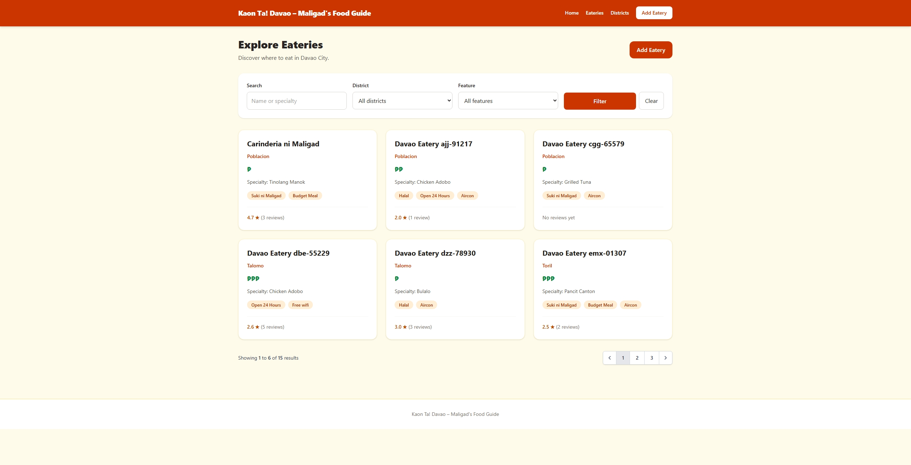
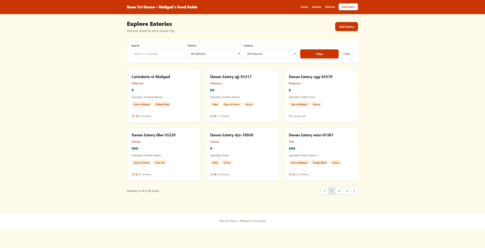
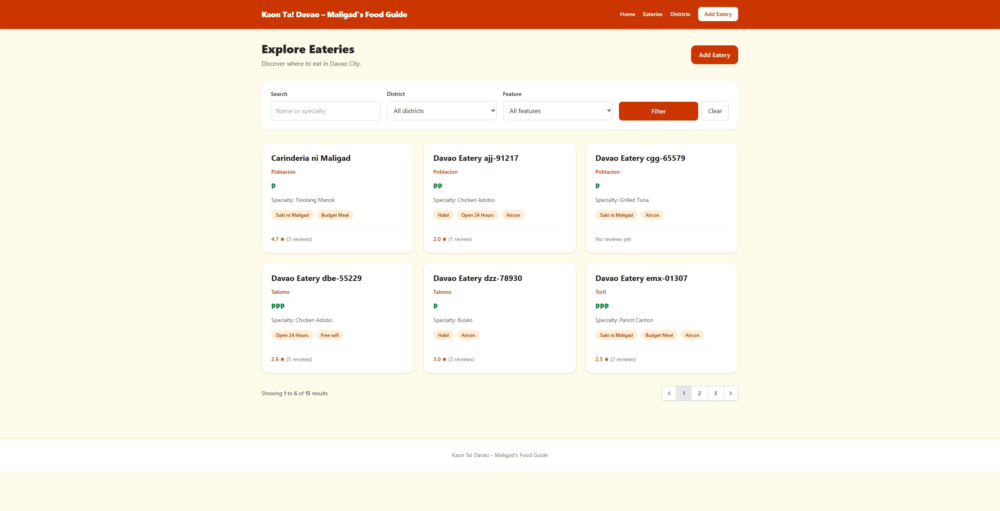

# Kaon Ta! Davao – Maligad's Food Guide

**Developer:** Trixia Maligad  
**Course:** CS Elective 2 – Full-Stack Development  
**Project:** Prefinal Milestone Project  
**Framework:** Laravel 12  
**Database:** SQLite

## Project Overview

Kaon Ta! Davao is a web application that helps residents and visitors explore local carinderias and eateries across Davao City.

The website allows users to browse eateries by district, search by name or specialty, filter by features, view dishes and business permits, and read or post reviews.

Users can also add, edit, and delete eateries. All pages are public, and reviewers are selected from seeded user accounts.

## Technologies Used

- PHP
- Laravel 12
- SQLite
- Blade Templates
- Tailwind CSS
- Vite
- Eloquent ORM

## Installation and Setup

Clone the GitHub repository and open the project directory.

Run the following commands:

```bash
composer install
cp .env.example .env
php artisan key:generate
touch database/database.sqlite
php artisan migrate:fresh --seed
npm install
npm run build
php artisan serve
```

For Windows PowerShell, the SQLite file can be created using:

```powershell
New-Item database/database.sqlite -ItemType File
```

After starting the server, open:

http://127.0.0.1:8000

## Personalized Seed Data

### Districts

1. Poblacion
2. Talomo
3. Agdao
4. Buhangin
5. Toril
6. Calinan

### Features

1. Suki ni Maligad
2. Budget Meal
3. Halal
4. Open 24 Hours
5. Aircon
6. Free wifi

### Seeded Users

| Name | Email |
|---|---|
| Trixia Maligad | maligad@kaonta.test |
| Tita Maligad | tita.maligad@kaonta.test |

Both users have the seeded password `kaonta2026`, which is stored as a hash.

Ten additional users are generated using Laravel's UserFactory.

### Personalized Eatery

| Field | Value |
|---|---|
| Name | Carinderia ni Maligad |
| Slug | carinderia-ni-maligad |
| District | Poblacion |
| Address | San Pedro St., Poblacion, Davao City |
| Price Range | budget |
| Specialty | Tinolang Manok |
| Status | Open |
| Permit Number | DVO-2026-0916 |
| Permit Expiration | September 16, 2027 |

The eatery has exactly two features: Suki ni Maligad and Budget Meal.

### Dishes

| Dish | Price | Bestseller |
|---|---|---|
| Tinolang Manok | ₱85.00 | Yes |
| Kinilaw na Tuna | ₱120.00 | No |
| Durian Shake | ₱75.00 | No |

### Personalized Review

**Reviewer:** Tita Maligad  
**Rating:** 5 stars

Lami kaayo! Balik-balikan ni Tita Maligad.

### Additional Seed Data

The application generates 14 other eateries through EateryFactory, including exactly 3 closed eateries.

Each additional eatery has one permit, 2–5 dishes, and 1–3 features. Open factory eateries may receive 0–6 reviews, while closed eateries receive none.

## Eloquent Relationships

| Models | Relationship Type | Explanation |
|---|---|---|
| District → Eatery | hasMany | A district can contain several eateries. |
| Eatery → District | belongsTo | Each eatery is assigned to one district. |
| Eatery → Dish | hasMany | An eatery can serve multiple dishes. |
| Dish → Eatery | belongsTo | Each dish belongs to one eatery. |
| Eatery → Review | hasMany | An eatery can receive multiple reviews. |
| Review → Eatery | belongsTo | Each review refers to one eatery. |
| User → Review | hasMany | A user can write multiple reviews. |
| Review → User | belongsTo | Each review is written by one user. |
| Eatery → Permit | hasOne | Each eatery has one business permit. |
| Permit → Eatery | belongsTo | Each permit is assigned to one eatery. |
| Eatery → Feature | belongsToMany | An eatery can have several features, and each feature can belong to multiple eateries. |
| Feature → Eatery | belongsToMany | A feature can be associated with several eateries through the eatery_feature pivot table. |
| District → Review | hasManyThrough | A district can access reviews from its eateries through the Eatery model. |

## Application Routes

The application defines routes for the homepage, eatery management, reviews, districts, and reviewer pages.


```text
GET|HEAD    /                         home                    HomeController
GET|HEAD    districts                 districts.index         DistrictController@index
GET|HEAD    districts/{district}      districts.show          DistrictController@show
GET|HEAD    eateries                  eateries.index          EateryController@index
POST        eateries                  eateries.store          EateryController@store
GET|HEAD    eateries/create           eateries.create         EateryController@create
GET|HEAD    eateries/{eatery}         eateries.show           EateryController@show
PUT|PATCH   eateries/{eatery}         eateries.update         EateryController@update
DELETE      eateries/{eatery}         eateries.destroy        EateryController@destroy
GET|HEAD    eateries/{eatery}/edit    eateries.edit           EateryController@edit
POST        eateries/{eatery}/reviews eateries.reviews.store  ReviewController@store
GET|HEAD    reviewers/{user}          reviewers.show          ReviewerController@show
DELETE      reviews/{review}          reviews.destroy         ReviewController@destroy

Showing [13] routes
```


## Screenshots

### Eatery List



### Eatery Details with Reviews



### Create Form with Validation Errors


